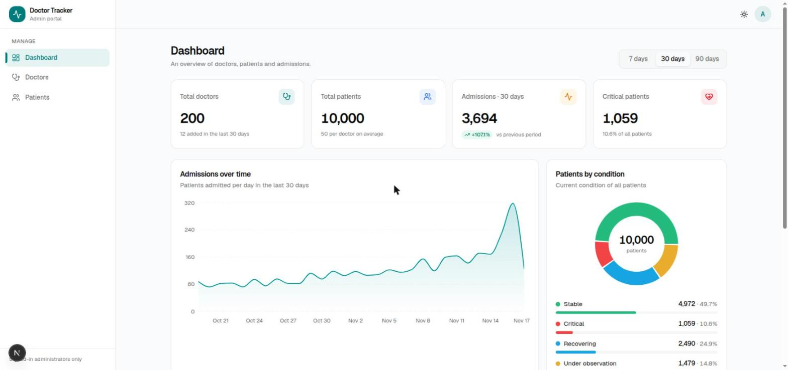
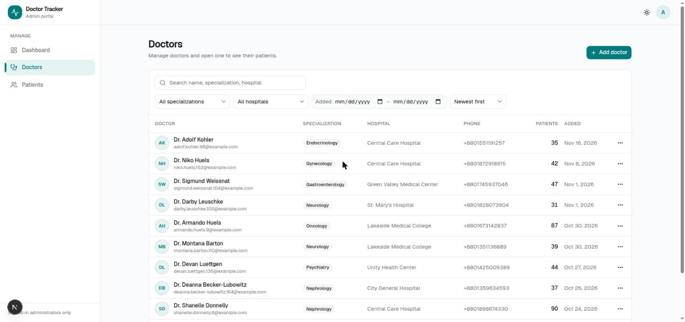
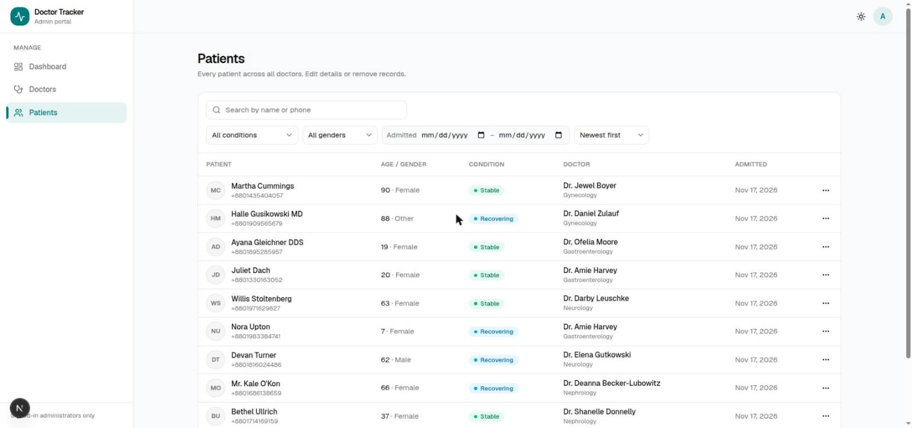
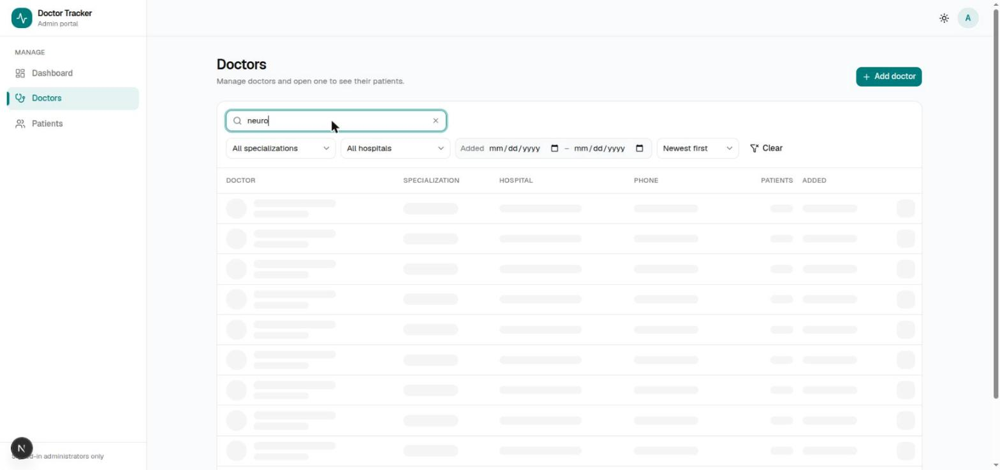
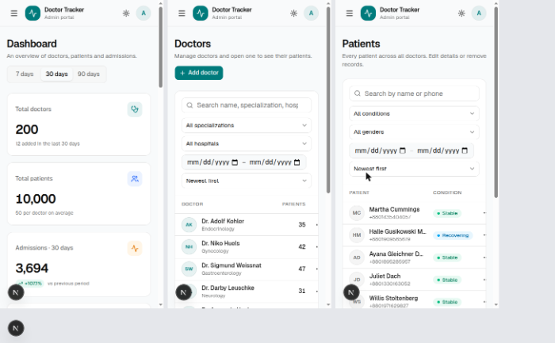

# Doctor Tracker

## Description

Doctor Tracker is a secure admin portal for managing doctors and their patients. A signed-in administrator can add doctors, open any doctor to manage that doctor's patients, search and filter thousands of records with server-side pagination, and read a dashboard of admission trends, patient conditions and doctor workload. It is built as a Next.js client talking to a standalone Express + MongoDB REST API, with a focus on index-backed queries, fast perceived performance (shimmer loaders, optimistic updates, prefetching) and a clean, responsive interface.

## Features

- **Authentication** — email/password login (Better Auth), httpOnly session cookie, every page and every API endpoint protected, admin-only authorization, no public sign-up.
- **Doctors** — create, edit, delete, profile photos, list, prefix search, filter by specialization / hospital / date added, sort by any column, paginate, CSV export; each doctor's page shows their patients plus an admissions trend and condition mix.
- **Patients** — dedicated page listing all patients; details panel; edit; change condition straight from the list; select several rows to export or delete; delete with a 5-second undo; search by name or phone; filter by condition / gender / admission date; sort by name, age or admission; CSV export; add a patient from the Patients page (with a searchable doctor picker) or from a doctor's page.
- **Dashboard** — totals, admissions over time (7 / 30 / 90 days), patients by condition, patients per doctor, doctors by specialization. Every card and chart is clickable and opens the matching filtered list.
- **UX** — shimmer skeletons on every page, date range picker with presets, removable filter chips, search field in the top bar with instant results across doctors and patients (Ctrl+K), keyboard shortcuts (`/` search, `N` add), collapsible sidebar (auto-collapsed below 1280px), card lists and a filter sheet on phones, optimistic edits, URL-synced filters, toasts, light/dark theme, reduced-motion support.

## Tech Stack

| Part | Technology |
|------|------------|
| Client | Next.js 16 (App Router), React 19, TypeScript, Tailwind CSS 4, shadcn/ui, TanStack Query, React Hook Form + Zod, Recharts |
| Server | Node.js, Express 5, TypeScript, Mongoose, Zod, Better Auth, Helmet, express-rate-limit, AWS SDK (S3), Multer, Sharp |
| Database | MongoDB |
| File storage | S3-compatible bucket (Railway bucket in production, SeaweedFS locally) |
| API | REST (`/api/v1`) |

## Setup Guide

**Prerequisites:** Node.js 20+, pnpm, and MongoDB (Docker is the quickest way).

```bash
# 1. Start MongoDB (localhost:27018) and local photo storage (localhost:8333)
docker compose up -d

# 2. Server
cd server
cp .env.example .env        # then set BETTER_AUTH_SECRET and SEED_ADMIN_PASSWORD
pnpm install
pnpm seed                   # creates the admin + 200 doctors and 10,000 patients
pnpm dev                    # http://localhost:4000

# 3. Client (in a second terminal)
cd client
cp .env.example .env.local
pnpm install
pnpm dev                    # http://localhost:3000
```

Open <http://localhost:3000> and sign in with the `SEED_ADMIN_EMAIL` and `SEED_ADMIN_PASSWORD` values from `server/.env`.

Generate a secret with `openssl rand -base64 32`. Using MongoDB Atlas instead of Docker only requires changing `MONGODB_URI`.

### Environment variables

| File | Variable | Purpose |
|------|----------|---------|
| `server/.env` | `PORT` | API port (default 4000) |
| | `MONGODB_URI` | MongoDB connection string |
| | `CLIENT_URL` | Origin of the client, used for CORS and trusted origins |
| | `BETTER_AUTH_SECRET` | Secret for signing sessions (32+ characters) |
| | `BETTER_AUTH_URL` | Public origin the browser uses — the client origin |
| | `SEED_ADMIN_NAME` / `SEED_ADMIN_EMAIL` / `SEED_ADMIN_PASSWORD` | Admin account created by the seed |
| | `S3_ENDPOINT`, `S3_REGION`, `S3_BUCKET`, `S3_ACCESS_KEY_ID`, `S3_SECRET_ACCESS_KEY`, `S3_FORCE_PATH_STYLE` | Photo storage. Optional: when unset, photo uploads are switched off and doctors show initials |
| `client/.env.local` | `API_URL` | Base URL of the Express API |

### Scripts

| Where | Command | What it does |
|-------|---------|--------------|
| server | `pnpm dev` / `pnpm build` / `pnpm start` | Run in watch mode / compile / run compiled |
| server | `pnpm seed` | Reset sample data (`-- --doctors=50 --patients=500`, or `-- --admin-only`) |
| client | `pnpm dev` / `pnpm build` / `pnpm start` | Next.js dev server / production build / serve build |
| both | `pnpm typecheck`, client `pnpm lint` | Static checks |

## System Architecture

```
┌──────────┐   /login, /dashboard, …   ┌────────────────────┐
│          │ ────────────────────────► │  Next.js client    │
│ Browser  │                           │  (static shells +  │
│          │ ── /api/* (same origin) ─►│   rewrite proxy)   │
└──────────┘                           └─────────┬──────────┘
                                                 │ forwards /api/*
                                                 ▼
                                       ┌────────────────────┐      ┌──────────┐
                                       │  Express REST API  │ ───► │ MongoDB  │
                                       │  auth · validation │      └──────────┘
                                       │  services · models │
                                       └────────────────────┘
```

**Request flow**

1. The browser only ever talks to the Next.js origin. `next.config.ts` rewrites `/api/*` to the Express server, so the session cookie is first-party and there are no CORS preflights.
2. `client/src/proxy.ts` gives a fast redirect to `/login` when no session cookie exists. This is a convenience, not the security boundary.
3. Pages are prerendered static shells. Client components read list state from the URL and fetch through TanStack Query.
4. On the server, `/api/auth/*` is handled by Better Auth. Every `/api/v1/*` route passes `requireAuth` (valid session) and `requireAdmin` (role check) before reaching a router.
5. Routers validate input with Zod, call a service, and return a uniform envelope. One error handler maps validation errors, duplicate keys, bad ids and unknown errors to consistent JSON.

**Response envelope**

```jsonc
{ "success": true, "data": [], "meta": { "page": 1, "limit": 10, "total": 200, "totalPages": 20 } }
{ "success": false, "message": "Validation failed", "errors": [{ "field": "email", "message": "Enter a valid email address" }] }
```

**REST endpoints** (all under `/api/v1`, all require an admin session)

| Method | Endpoint | Purpose |
|--------|----------|---------|
| GET | `/doctors` | List — `page`, `limit`, `search`, `specialization`, `hospital`, `from`, `to`, `sortBy` (`createdAt`, `name`, `specialization`, `hospital`), `order` (`asc`, `desc`) |
| GET | `/doctors/export` | Same filters and sort as the list, streamed as CSV |
| POST | `/doctors` | Create a doctor |
| GET | `/doctors/filters` | Distinct specializations and hospitals for the filter menus |
| GET / PATCH / DELETE | `/doctors/:id` | Read, update, delete (delete is refused while the doctor has patients) |
| GET | `/doctors/:id/stats` | Condition mix, admissions per day (30 days), average age, last admission |
| GET | `/doctors/:id/photo` | Redirects to a short-lived signed link for the photo |
| PUT / DELETE | `/doctors/:id/photo` | Upload (multipart field `photo`) or remove the photo |
| GET | `/meta` | Optional features the client should show, e.g. `{ "photoUploads": true }` |
| GET | `/doctors/:id/patients` | That doctor's patients, paginated and filterable |
| POST | `/doctors/:id/patients` | Add a patient under the doctor |
| GET | `/patients` | List — `page`, `limit`, `search`, `condition`, `gender`, `doctor`, `from`, `to`, `sortBy` (`admittedAt`, `name`, `age`), `order` |
| GET | `/patients/export` | Same filters and sort as the list, streamed as CSV |
| PATCH / DELETE | `/patients/:id` | Update or delete a patient |
| GET | `/dashboard/stats?days=30` | All dashboard statistics |

Authentication endpoints (`/api/auth/sign-in/email`, `/api/auth/sign-out`, `/api/auth/get-session`) are provided by Better Auth.

**Folder structure**

```
client/src
├── app/                 # routes: (auth)/login, (portal)/dashboard · doctors · doctors/[id] · patients
├── components/
│   ├── ui/              # shadcn/ui primitives
│   ├── layout/          # app shell, sidebar, header, theme toggle, user menu
│   └── shared/          # DataTable, PaginationBar, SearchInput, filters, skeletons, dialogs
├── features/            # auth, doctors, patients, dashboard — api hooks, schemas, components
├── hooks/               # URL state, debounce, count-up, row highlight
├── lib/                 # API client, auth client, formatting
└── proxy.ts             # optimistic route protection

server/src
├── config/              # validated env, database connection
├── lib/auth.ts          # Better Auth instance
├── middlewares/         # requireAuth, requireAdmin, error handler
├── modules/             # doctors, patients, dashboard — routes, validation, service, model
├── utils/               # ApiError, response helpers, search tokens, shared validation
└── scripts/seed.ts
```

## Technical Decisions

### 1. Token-prefix search on a multikey index instead of `$text` or regex

Search has to feel instant while typing, on collections that keep growing. The two obvious MongoDB options both fall short:

- **`$text`** only matches whole (stemmed) words. Typing `car` does not find `Cardiology`, so results appear only once a word is finished.
- **Case-insensitive or unanchored `$regex`** (`/car/i`) finds everything but cannot use an index, so every search scans the whole collection.

Instead, each document stores a `searchTokens` array: the lowercase words of its searchable fields (name, specialization, hospital, email for doctors; name and phone for patients). The array has a multikey index. A query is split into words, and each becomes an **anchored prefix regex** on that field:

```js
// "car gen" →
{ $and: [{ searchTokens: /^car/ }, { searchTokens: /^gen/ }] }
```

An anchored, case-sensitive prefix regex is turned by MongoDB into a tight index range scan, so `car` matches "Cardiology" and "Central **Car**e Hospital" by reading only the matching index entries. Every word must match, which makes multi-word searches narrow results as expected.

Trade-offs: tokens are maintained on every write (the service layer recomputes them on create and update, since update queries skip document middleware), each document carries a small extra array, and matches are prefix-of-word rather than arbitrary substring. For name/phone lookup that is the behaviour people expect, and it is far cheaper than a scan. The rest of the indexing follows the same idea — compound indexes with the equality field first and the sort keys after it, including the `_id` tiebreaker used for stable pagination (`{ specialization: 1, createdAt: -1, _id: -1 }`, `{ doctor: 1, admittedAt: -1, _id: -1 }`, `{ condition: 1, admittedAt: -1, _id: -1 }`), so a page of 10 rows examines 10 index keys instead of sorting in memory, `estimatedDocumentCount` for unfiltered totals, `lean()` reads with only the displayed fields, and separate parallel aggregation pipelines for the dashboard instead of one `$facet` (whose sub-pipelines cannot use indexes).

### 2. TanStack Query + URL state instead of Redux or the Context API

Almost all state in this app is either **server state** (lists, a doctor, statistics) or **view state for a list** (page, search text, filters, sort). Very little is true client state.

- **Server state → TanStack Query.** Redux or Context would mean hand-writing caching, request deduplication, loading/error flags, cancellation and invalidation. TanStack Query provides those, and enables the UX details that make the app feel fast: the previous page's totals stay on screen while the next page loads (`keepPreviousData`), the next page is prefetched so "Next" is instant, and patient edits and deletes are **optimistic** — the cache is updated immediately, then rolled back with an error toast if the server rejects the change. Query keys are produced by small key factories per feature, so a mutation invalidates exactly the lists, counts and dashboard data it affects.
- **List view state → the URL.** Page, search and filters live in search params, written with the History API (which Next.js keeps in sync with `useSearchParams` without a server round trip). That gives shareable and bookmarkable views and a working back button for free, and removes a global store entirely.
- **Re-render control.** Because nothing sits in a global store, a keystroke only re-renders the search input (which debounces before touching the URL). Table rows are memoized and keep their object identity across refetches, so only rows whose data changed re-render.

The cost is an extra dependency and that list state is not available outside the component tree — neither matters here. Context is still used, but only where it fits: theme and the query client.

### Also worth noting

- **Doctor photos in a private bucket.** Uploads go through the API, which accepts JPG, PNG or WebP up to 5 MB, decodes the file with Sharp (so a renamed non-image is rejected) and stores a 256×256 WebP of about 10–20 KB under a new random key. Only the key is saved on the doctor. Clients get `/api/v1/doctors/:id/photo?v=…`, which checks the session and redirects to a signed bucket link, so image bytes come from the storage provider rather than the API server. The signing time is rounded to the hour, so the link stays the same for an hour and the browser can cache it. Replacing or removing a photo, or deleting the doctor, deletes the old object.

- **Same-origin proxy for auth.** The client and API are separate deployments, which normally forces `SameSite=None` cookies and CORS. Routing `/api/*` through a Next.js rewrite keeps the session cookie first-party and httpOnly, so it is never readable by JavaScript and never sent cross-site.
- **Dates as UTC calendar days.** Admission dates are stored at noon UTC and filtered and displayed in UTC, so the day picked in a filter is always the day shown in the table, regardless of the viewer's time zone.

## Visual Evidence

### Desktop

| Dashboard | Doctors |
|-----------|---------|
|  |  |

| Patients | Shimmer loading state |
|----------|-----------------------|
|  |  |

### Mobile



## Deployment Notes

- **Database:** MongoDB Atlas. Run `pnpm seed -- --admin-only` once against it to create the admin account. The server creates any missing index on every start (existing ones are left alone), so new indexes ship with the deploy that adds them.
- **Server:** any Node host (Render, Railway, a VPS). Set the variables from `server/.env.example`; `CLIENT_URL` and `BETTER_AUTH_URL` are both the deployed client origin.
- **Client:** Vercel or any Node host. Set `API_URL` to the deployed server URL, without a trailing slash.
- **Photos (Railway):** add a bucket, then on the server service set `S3_ENDPOINT=${{Bucket.ENDPOINT}}`, `S3_REGION=${{Bucket.REGION}}`, `S3_BUCKET=${{Bucket.BUCKET}}`, `S3_ACCESS_KEY_ID=${{Bucket.ACCESS_KEY_ID}}` and `S3_SECRET_ACCESS_KEY=${{Bucket.SECRET_ACCESS_KEY}}` (replace `Bucket` with the bucket's name in Railway). Set `S3_FORCE_PATH_STYLE=true` only if the bucket's Credentials tab says to use path-style URLs.
